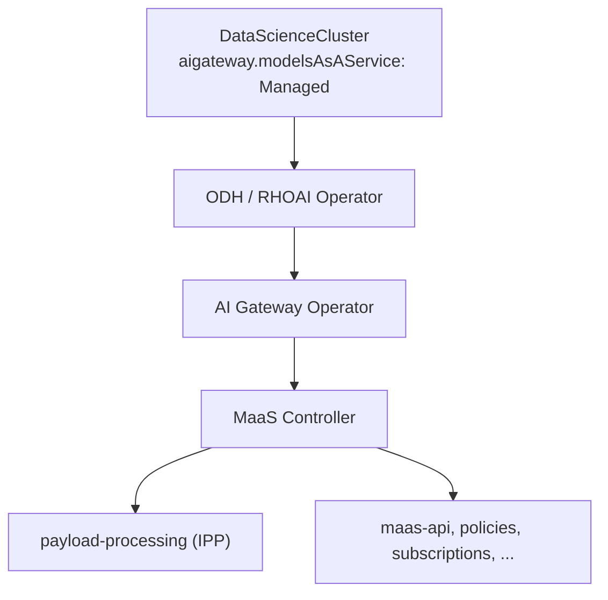
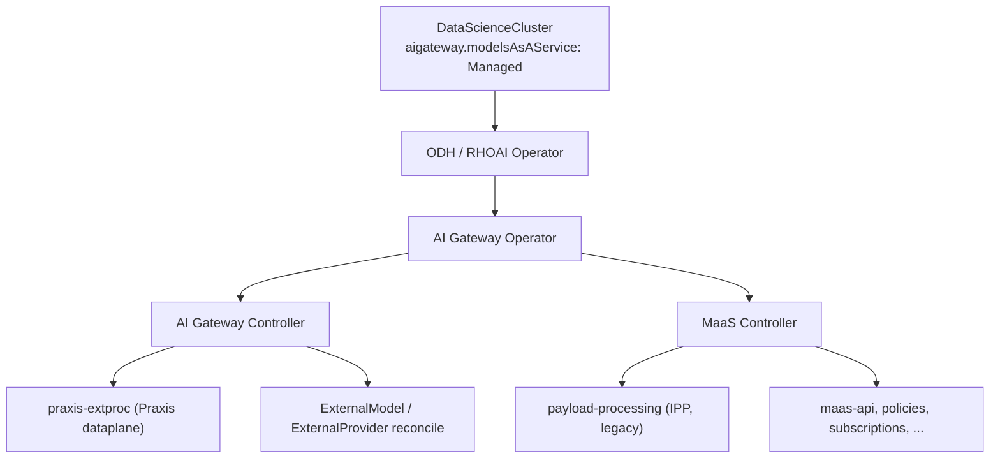

# ai-gateway-controller — Design

Architecture decisions are maintained in the Open Data Hub ADR repository.
The External Model/Praxis two-plane decision is tracked as
[ODH-ADR-MS-0005](https://github.com/opendatahub-io/architecture-decision-records/pull/165),
so this implementation repository does not carry a second authoritative copy.

## Status

**Phase 1:** `make build` (tidy, lint, test, binary) passes clean. Not yet
built into a released image, not yet pushed to a remote, not yet wired
end-to-end into a live `ai-gateway-operator` reconcile (see "Out of scope").

**Phase 2 (EA2):** the multi-tenant Praxis-vs-IPP fan-out and ExternalModel
control plane are implemented. `pkg/tenant` primarily watches
`MaasTenantConfig` — mirroring
maas-controller's own `TenantReconciler` — and, for every tenant whose
`metadata.annotations["maas.opendatahub.io/payload-processing-type"]` is
`"praxis"`, renders, SSA-applies, and (on switch-away or deletion) cleans
up a per-tenant copy of the vendored `praxis-extproc` manifests — replacing
Phase 1's single unconditional global install. `pkg/controller` reconciles
`ExternalModel` / `ExternalProvider` resources into the tenant-local ExtProc
overlay, credential projections, and Envoy-owned provider transport.

## Purpose

### ExternalModel handoff and transport cleanup ownership

`ai-gateway-controller` reads `payload-processing-type` and
`payload-processing-status` only from the tenant-local `MaasTenantConfig`.
It publishes ExternalModel serving state only after the selector is Praxis and
the handoff status is `steady`; the tenant reconciler owns the transition to
`steady` and `cleanup-complete`. An explicit `ipp` selector is a cleanup
request and does not wait for `steady`. A missing configuration is retained
for non-deleting models, while deleting models use controller ownership labels
and the model namespace to complete safe final-model cleanup.

Gateway-local provider `DestinationRule` objects and the route `EnvoyFilter`
carry the model namespace, tenant identifier, and current Gateway name and
namespace. On a Gateway move, the controller applies the new copy first and
removes only the old copy carrying the same tenant identity. Neighboring
tenant and foreign-controller resources are not candidates for deletion.

The pre-PR DestinationRule shape from `origin/main` was
`provider-<provider>` in the Gateway namespace with only
`app.kubernetes.io/managed-by=ai-gateway-controller` and
`inference.opendatahub.io/external-provider=<provider>` labels. It has no
tenant or Gateway identity and is therefore inherently ambiguous in a shared
Gateway namespace. The controller intentionally leaves such an object alone;
an operator must perform a targeted manual migration after identifying its
owner. New controller-owned rules are unambiguous and are cleaned up by the
normal handoff/finalizer path.

If a deleting ExternalModel has no resolvable `MaasTenantConfig`/`AITenant` and
there are sibling models, deletion is conservative: it will not rebuild shared
Praxis serving state without a live, steady tenant handoff. The ExternalModel
finalizer remains until the owning handoff objects are restored or the sibling
models are removed. Final-model deletion can clean controller-owned state
using its namespace and ownership labels. Ambiguous pre-PR resources are never
removed by a label-only sweep.

`ai-gateway-controller` is the AI Gateway control-plane controller. Target
state (3.6): sibling of `maas-controller`, both deployed by
`ai-gateway-operator`:

```
ai-gateway-operator ──deploys──▶ ai-gateway-controller ──reconciles──▶ external models (control plane)
ai-gateway-operator ──deploys──▶ ai-gateway-controller ──installs──▶ praxis-extproc (dataplane)
ai-gateway-operator ──deploys──▶ maas-controller ──installs──▶ maas-api
```

This repo replaces the control-plane half of `payload-processing` (IPP):
watching `ExternalModel` / `ExternalProvider` and generating per-model
configuration. The dataplane half moves to **Praxis** (`praxis-extproc`).

Today `maas-controller` deploys the required infrastructure
(CRDs, Deployments, etc.) and the IPP repo watches `ExternalModel` /
`ExternalProvider`, doing both control-plane reconciliation and the ExtProc
dataplane. 3.5 ships only `maas-controller` + IPP; see
[Deployment architecture](#deployment-architecture).

**Phase 1 (implemented today)** vendors and installs `praxis-extproc`
manifests only.

**Phase 2 (EA2, implemented)** primarily watches `MaasTenantConfig` and, per
opted-in tenant, applies and cleans up its own per-tenant ExtProc resources.
It also watches `ExternalModel` / `ExternalProvider` and publishes dynamic
per-model routing, provider transport, and reference-only credentials
(credentials from outside a tenant namespace are delivered through copies; see
[Gateway attachments](#gateway-attachments)).

## Deployment architecture

### Current architecture (3.5)



- **Operator chain:** `DataScienceCluster` (`aigateway.modelsAsAService: Managed`) → ODH/RHOAI operator → AI Gateway Operator → **`maas-controller` only**.
- **`ai-gateway-controller` is not deployed in 3.5.** ExtProc dataplane is **IPP** (`payload-processing`), owned entirely by MaaS.
- **`maas-controller` bootstraps infrastructure** (CRDs, Deployments, gateway policies, etc.).
- **IPP owns both control plane and dataplane for external models:**
  - Watches `ExternalModel` / `ExternalProvider` and reconciles per-model configuration.
  - Runs the ExtProc dataplane (Deployment, EnvoyFilter, plugins ConfigMap).
- **`AITenant` is a MaaS-owned object:**
  - `maas-controller` bootstraps `AITenant/models-as-a-service` on startup.
  - AITenant reconciler drives tenant namespace, `MaasTenantConfig`, maas-api, and gateway-scoped platform resources per tenant.
- **IPP is injected through MaaS tenant reconciliation:**
  - Tenant reconcile deploys `payload-processing` based on the owning `AITenant`.
  - No `AITenant` field to pick dataplane backend — IPP is always what gets installed.

### 3.6 architecture (target)



- **AI Gateway Operator deploys two sibling controllers:**
  - **`ai-gateway-controller`** — external-model control plane (watch + reconcile `ExternalModel` / `ExternalProvider`) and installs `praxis-extproc` (Praxis dataplane).
  - **`maas-controller`** — MaaS platform (maas-api, gateway policies, subscriptions, telemetry, infrastructure bootstrap).
- **Control-plane / dataplane split (replaces IPP's dual role):**
  - **`ai-gateway-controller`** — deployment and reconciling of external models (per-model config generation, formerly in IPP).
  - **Praxis (`praxis-extproc`)** — ExtProc dataplane only.
- **`MaasTenantConfig` selects the dataplane backend per tenant (EA2 / Phase 2, implemented):**
  - `MaasTenantConfig.metadata.annotations["maas.opendatahub.io/payload-processing-type"] == "ipp"` selects **IPP** (`payload-processing`); absent, empty, or unrecognized values follow the current **Praxis** default (via `ai-gateway-controller`'s `pkg/tenant`). This annotation lives only on `MaasTenantConfig` — it is never mirrored to/from `AITenant` — so both controllers always read the same single source of truth from the same object they both watch.
  - Lets 3.6 support both backends during the Praxis migration, one tenant at a time, with a race-free handoff (see [Approach](#approach)) when a tenant swaps backends.
- **Multi-tenancy works the same way it does today:**
  - `MaasTenantConfig` / `AITenant` fan-out drives per-tenant namespaces, gateway binding, and dataplane install — no change to the tenancy model, only which ExtProc backend is selected.
- **Split of responsibilities:**
  - **`ai-gateway-controller`** — external-model control plane, `praxis-extproc` install, per-tenant Praxis/IPP dataplane selection.
  - **`maas-controller`** — MaaS auth, rate limits, API keys, model refs, subscription/policy concerns under that tenant.
- **Lifecycle toggle (decided):** `ai-gateway-controller` shares
  `AIGateway.spec.modelsAsAService.managementState` with `maas-controller`.
  There is no dedicated `AIGatewaySpec` toggle for this component: when MaaS
  is `Managed`, `ai-gateway-operator` deploys both siblings; when MaaS is
  `Removed`, both tear down (with the same teardown-grace-period window
  `maas-controller` uses, since praxis-extproc may still be serving traffic
  MaaS's own teardown depends on). `ModelsAsAServiceReady` reflects both
  Deployments.

## Approach

`praxis-extproc`'s manifests live in a separate repo, so they need
cross-repo, commit-pinned vendoring (the pattern `ai-gateway-operator` uses
for `maas-controller`). But `praxis-extproc`'s `deploy/overlays/odh` ships
placeholder values (namespace, gateway name, route names, and fixed resource
names) that must be rewritten by whoever installs it — vendor-and-apply
alone isn't enough; a post-render step is required too.

This repo combines both: pinned-commit vendoring into
`config/manifests/praxis-extproc/`, then a lightweight `controller-runtime`
manager (no `opendatahub-operator/v2` dependency) that primarily watches
`MaasTenantConfig` (`pkg/tenant`) — mirroring maas-controller's own
`TenantReconciler`, which watches the same object — and, for every tenant
whose payload-processing annotation is `praxis`, does kustomize build →
placeholder post-render → per-tenant rename/patch → SSA apply into that
tenant's Gateway namespace. Both controllers watching the same primary
object (rather than `ai-gateway-controller` watching `AITenant` while
`maas-controller` watches `MaasTenantConfig`) means a backend-selection
write is a single watch event both sides observe together, with no
cross-object propagation lag between them.

`status.gatewayRef` and `status.phase` still live on `AITenant`, not
`MaasTenantConfig`, so this controller also Gets a tenant's owning `AITenant`
(via the `aitenant-name`/`aitenant-namespace` annotations maas-controller's
own `AITenantReconciler` already stamps onto every AITenant-managed
`MaasTenantConfig`) and gates apply on `status.phase == "Active"` there, so
nothing is applied before maas-controller has actually validated the
Gateway and finished bootstrapping the tenant. Both CRDs are read as
`unstructured.Unstructured` against hardcoded `schema.GroupVersionKind`s
rather than by importing `models-as-a-service/maas-controller`'s Go types:
that module's `go.mod` pulls in `kserve`, `knative`, `KEDA`, `openshift/api`,
and more, none of which this controller needs to keep its own dependency
graph minimal.

A `PraxisCleanupFinalizer` on the `MaasTenantConfig` (not `AITenant`)
guarantees a chance to delete what was applied when a tenant switches away
from `praxis` or the `MaasTenantConfig` is deleted (SSA only ever upserts
the current render set, it never deletes what falls out of it) — mirroring
maas-controller's own `tenant-cleanup` finalizer pattern on the same object.
Putting the finalizer on `MaasTenantConfig` rather than `AITenant` is
deliberate: maas-controller's own `AITenantReconciler.deleteTenantConfig`
already blocks `AITenant` deletion until `MaasTenantConfig` — and therefore
every finalizer on it, including this one — is fully gone, so `AITenant`
deletion ordering falls out of that existing mechanism for free, with no
separate coordination needed. `DeletionTimeout` bounds how long cleanup
retries before force-removing the finalizer without confirming cleanup
succeeded, same as before.

### Payload-processing backend swap handshake

Legacy IPP (maas-controller) and Praxis (this repo) share the same
Gateway-namespace resource names (`payload-processing`,
`payload-pre-processing`, etc.), so switching a tenant's
`payload-processing-type` annotation hands the same names off between two
independent controllers. Without coordination this is racy — see
`maas-controller`'s `tenantreconcile.AnnotationPayloadProcessingStatus`
doc comment for the full state machine this mirrors. In short:

- The status annotation (`maas.opendatahub.io/payload-processing-status`)
  lives only on `MaasTenantConfig` and has three meaningful states:
  - `cleanup-complete`: clear to claim. The party currently selected by
    `payload-processing-type` may CAS-claim and start deploying.
  - `steady`: praxis owns the dataplane and may resume/apply. Legacy must
    wait until praxis switch-off writes `cleanup-complete`.
  - **absent**: legacy steady when legacy is selected (existing tenants are
    assumed to run legacy IPP); blocked when praxis is selected (wait for
    legacy cleanup). Brand-new tenants are seeded with `cleanup-complete`
    at `MaasTenantConfig` creation time so their first deploy is never
    blocked by absent.
- Claiming for praxis (`EnsurePraxisMayDeploy` / `claimPraxisSteady`) writes
  `steady` via an optimistic-concurrency `Update`. Legacy's mirror claim
  deletes the annotation back to absent. Concurrent claims on the same
  `cleanup-complete` value: only one `Update` wins; the other observes
  `Conflict` and re-evaluates.
- Status itself is the durable claim — apply failures after a successful
  claim resume on the next reconcile because status is already `steady`.
- If a tenant namespace's `MaasTenantConfig` (always named `default-tenant`,
  in every tenant namespace) is temporarily missing, the
  ExternalModel reconciler treats selection as unknown: it retains existing
  serving state, does not infer a backend from `AITenant`, and waits for the
  owner to recreate the config. Cleanup is performed only after an explicit
  `ipp` selection (or the established deletion handoff), never merely because
  the selector object disappeared.
- After a full, successful switch-off cleanup (`Reconciler.cleanup`), this
  controller writes `cleanup-complete` (`MarkPayloadProcessingCleanupComplete`)
  so maas-controller may claim to absent and (re)deploy legacy IPP.

### Gateway attachments

`spec.gatewayRefs` ([RHOAIENG-90801](https://redhat.atlassian.net/browse/RHOAIENG-90801))
serves a model through explicitly selected tenant Gateways, including models in
user namespaces and models shared by several tenants. The contract is the
RHOAIENG-90800 compatibility one pager; this section records how it is
implemented (`pkg/controller/attachment.go`).

**Home attachment.** A model is served by its own tenant (the tenant whose
`MaasTenantConfig` is in the model namespace) when `gatewayRefs` is omitted or
names that tenant's Gateway. That path is the existing tenant-local path with
unchanged resources, identifiers, labels, overlay content and deletion. A
model without `gatewayRefs` in a namespace that has no `MaasTenantConfig` and
was never served there gets no serving state: phase `Pending`, `Ready=False`,
reason `TenantNotResolved`. A tenant-namespace model whose `gatewayRefs` no
longer name its own tenant is removed from the tenant-local set; the tenant
republishes without it once steady. An explicit binding never falls back to
another Gateway.

**Per-attachment resolution and gating.** Every other reference is an extra
attachment, resolved Gateway → owning `AITenant` (reverse lookup on
`status.gatewayRef`) → that tenant's `MaasTenantConfig`. No owner reports
`GatewayNotManaged`, several `AmbiguousTenant`. The existing backend handshake
gate then applies to that tenant alone: it must select Praxis and be `steady`
with an Active, current `AITenant` (otherwise `TenantNotSteady`, retaining the
attachment's existing state, including when the `MaasTenantConfig` is
temporarily missing). An explicit non-Praxis selection (`TenantNotPraxis`) is
the existing cleanup command: the attachment is removed. One attachment's
result never blocks another. Status reports the first failing attachment in
`gatewayRefs` order as a top-level `Ready=False` reason; per-Gateway status is
[RHOAIENG-90802](https://redhat.atlassian.net/browse/RHOAIENG-90802).

**Gateway-attachment authorization.** The attachment's HTTPRoute is created in
the model namespace first. The Gateway enforces its listener `allowedRoutes`;
AGC does not re-implement it and needs no Gateway or Namespace access. Only
after the route's parent status for that Gateway is `Accepted=True` are the
DestinationRule, credential copies and overlay entries published.
`Accepted=False` reports the Gateway's reason (for example
`NotAllowedByListeners`); no parent status yet reports `AttachmentPending`. A
later loss of acceptance withdraws the attachment's overlay entry, credential
copies and DestinationRules.
Default MaaS Gateways use `allowedRoutes.from: Same`, so serving user-namespace
models requires an administrator-configured namespace selector.

**Identifiers.** Extra attachments always have a model outside the tenant
namespace, so they use only the new, disjoint forms:

| Output | Extra attachment form |
| --- | --- |
| HTTPRoute (model namespace) | `external-model-<model>-<hash12>`, `external-model-<hash12>` above 253 characters |
| Gateway-namespace DestinationRule | `provider-<provider>-<hash12>`, at most 63 characters, with the existing ownership labels plus `inference.opendatahub.io/attachment-tenant` |
| Overlay `stable_id` | `<modelNamespace>/<model>/<providerNamespace>/<provider>`, or `sha256:<hex>` over the length-prefixed fields above 256 bytes |
| Credential copy (tenant namespace) | `agc-cred-<hash12>` |

Provider Services, ServiceEntries and the selection sink in the model
namespace keep their existing names (`provider-<provider>`): providers are
model-local until cross-namespace references are authorized
([RHOAIENG-90804](https://redhat.atlassian.net/browse/RHOAIENG-90804)), so the
overlay cluster also stays `provider-<provider>`. Hashed objects carry identity
annotations and are verified before AGC adopts them; a collision is an error,
never an overwrite. Attachment HTTPRoutes carry no
`inference.opendatahub.io/external-model` label and attachment DestinationRules
are skipped by tenant-local cleanup, so the two paths never delete each other's
objects; tenant-local cleanup keeps the model-namespace transport that the
namespace's attachment routes use.

**Tenant overlay and route filter.** Each tenant still has one overlay and one
route EnvoyFilter. The tenant-local path publishes its own candidates and route
patches followed by the admitted attachments. An attachment republishes only
the attachments: it preserves the tenant's own published candidates (existing
`stable_id` form) and own route patches (route names in the tenant namespace)
verbatim, so attachments never change or block the tenant's own serving.
Attachments are admitted per model, oldest first: resolution or credential
failures, more than 7 distinct providers (`TooManyProviders`; HTTPRoutes allow
16 rules, AGC uses two per provider plus two) and the 1024-candidate Praxis
overlay limit after the tenant's own candidates (`OverlayCapacityExceeded`)
exclude only that model. Model-name conflicts apply across namespaces only:
the tenant's own models keep their client-facing name, otherwise the oldest
model (`creationTimestamp`, then `namespace/name`) wins and the loser gets no
route, overlay entry or transport on that Gateway (`ModelNameConflict`, naming
the winner). An excluded model is withdrawn when it is reconciled: the tenant
republishes without it and its DestinationRules and credential copies are
deleted. A failing or conflicting model also loses its HTTPRoute; a model over
the overlay capacity keeps its accepted route, and so its place in admission
order. Capacity is decided, and the handoff re-checked live, before anything
is written into the tenant. A failed API read is retried rather than treated
as the model's failure, so it never withdraws a served attachment. The tenant reconciler adds the attachments' overlay candidates to
the external-model ExtProc configuration and mounts their credential copies;
as before, a configuration change restarts that Deployment.

**Credential copies.** A credential Secret in the tenant namespace is mounted
directly, as before. A Secret elsewhere (a provider outside the tenant
namespace, or a model-local override in a user namespace) is copied, referenced
key only, into a controller-owned `agc-cred-<hash12>` Secret in the tenant
namespace after route acceptance; the overlay candidate references the copy so
the existing mount and path logic is unchanged. Copies follow the source on
each reconcile (Secret events fan out to referencing models): a deleted source,
or one missing the key, excludes the model and deletes its copy. Copies are
also deleted once no attachment HTTPRoute of that tenant references them, or
on tenant teardown/switch-away. This is the only departure from the reference-only
credential model. It is exposure, not isolation: a copied credential is
readable by anyone who can read Secrets or create pods in the tenant
namespace, the same tier as tenant-local provider credentials; MaaS's
tenant-admin Role grants no Secret access. Writing copies requires the Secret
create/patch/delete permission from
[RHOAIENG-90808](https://redhat.atlassian.net/browse/RHOAIENG-90808).

**Per-attachment deletion.** Removing a reference (or all of them, which
restores tenant-local resolution) or deleting the model deletes only that attachment's identity-verified HTTPRoute, then the tenant's
DestinationRules and credential copies no remaining attachment route
references, and, outside tenant namespaces, model-namespace transport no
attachment uses. It never rebuilds shared tenant state and needs no deletion
timeout: the tenant's next steady publish drops the inert overlay entries (no
route reaches them, and the ExtProc skips candidates whose copy is gone), and
the tenant's cleanup finalizer removes copies and attachment DestinationRules
on teardown or switch-away. The tenant reconciler keeps the route EnvoyFilter
while attachment routes target the tenant, since attachment patches can be
written before it observes them in the overlay. The home attachment keeps the
existing deletion logic.

**Ownership.** Attachments reuse the backend handshake above per tenant: one
active external-model controller owns a tenant, and AGC publishes into a
tenant only while it is the selected, `steady` backend. Legacy IPP exclusion of
new-shaped objects is
[RHOAIENG-99761](https://redhat.atlassian.net/browse/RHOAIENG-99761). AGC
writes the status of providers used by an attachment, as it does for
tenant-local providers. A single-namespace controller (`--namespace`) serves no
attachments from other namespaces.

## Scope

### Phase 1 — `praxis-extproc` install (implemented)

- Vendor `deploy/overlays/odh` from `opendatahub-io/praxis-extproc@main` at a
  pinned commit (`hack/scripts/get-manifests.sh`) into
  `config/manifests/praxis-extproc/`, baked into the image via `Dockerfile`.
- `pkg/render`: kustomize build, placeholder post-render (target namespace,
  the `maas-default-gateway` placeholder, `PLACEHOLDER.maas-api-route.N`
  route names, `*.openshift-ingress.svc.cluster.local` FQDNs), and SSA-apply
  with a dedicated field owner (`ai-gateway-controller`). These primitives
  are tenant-agnostic; `pkg/tenant` (Phase 2) is what makes them per-tenant.
- PR/CI conventions — see [CONTRIBUTING.md](./CONTRIBUTING.md).

### Phase 2 — multi-tenancy + external models (EA2, implemented)

- **Implemented:** `pkg/tenant` primarily watches `MaasTenantConfig`
  (`maas.opendatahub.io/v1alpha1`) — mirroring maas-controller's own
  `TenantReconciler` — and, for every tenant whose
  `maas.opendatahub.io/payload-processing-type` annotation is absent or `praxis`,
  renders and applies a dedicated, per-tenant-named copy of the
  praxis-extproc resources (`{base}-{tenantID}`, the default/legacy tenant
  keeps the unsuffixed names) into that tenant's owning `AITenant`'s
  `status.gatewayRef` namespace, once that `AITenant`'s `status.phase` is
  `Active`. A secondary `AITenant` watch reacts to gatewayRef/phase changes
  that a `MaasTenantConfig`-only watch would miss. Tenants explicitly set to
  `ipp` are untouched — `maas-controller`'s own
  `TenantReconciler` owns their IPP deployment. The current product default is
  Praxis when the selector is absent; explicit `ipp` is the opt-out.
  `PraxisCleanupFinalizer` (on `MaasTenantConfig`) deletes a tenant's
  praxis-extproc resources when it switches away from `praxis` or its
  `MaasTenantConfig` is deleted; `--deletion-timeout` bounds how long that
  retries before force-removing the finalizer without confirmed cleanup.
  This controller does not write any `AITenant` at all (status or
  otherwise) — maas-controller's own `AITenant` reconciler owns it today.
- `pkg/controller` watches `ExternalModel` / `ExternalProvider` and publishes
  the content-addressed overlay, provider routes and transport, and Secret
  references. Tenant-local ExtProc runs `intelligent_route` and
  `credential_inject`; Envoy performs route reselection and the provider hop.

### Out of scope (explicitly deferred)
- Watching `AIGateway` (or any CR) from this controller. Lifecycle is
  owned by `ai-gateway-operator` via the shared
  `ModelsAsAService.ManagementState` toggle (see [3.6 architecture](#36-architecture-target));
  this controller only needs its `MaasTenantConfig` and `AITenant` watches.
- End-to-end verification of the `ai-gateway-operator` wiring described in
  [Repo layout](#repo-layout) (RBAC sufficiency, image-param injection,
  deploy/teardown alongside `maas-controller` under the shared MaaS toggle).
  `ai-gateway-operator` already vendors this repo's `config/self` (no
  `exclude_path` needed) and appends it when
  `ModelsAsAService.ManagementState == Managed` in
  `internal/controller/aigateway/aigateway.go`; a real vendoring/deploy run
  from this repo's side has not been confirmed yet.

## Inference API schema extension

[RHOAIENG-90800](https://redhat.atlassian.net/browse/RHOAIENG-90800) is a bounded,
additive extension to ODH-ADR-MS-0005's frozen migration baseline. AGC's
`api/inference/v1alpha1` types and generated `config/crd/bases` schemas source
the new fields. Retain the ADR's local API mirrors and CI drift checks;
MaaS installs the inference CRDs, and operator manifest pins propagate them.
AGC, MaaS and API owners agreed this extension separately from the migration
baseline.

`spec.gatewayRefs` is optional, with 1–16 unique namespace/name pairs when
present. Omission retains tenant-local resolution without a global default.
`status.gateways` uses the same full identity, optional `httpRouteRef`
name/namespace, and conditions keyed by type whose `observedGeneration`
refers to the model generation. Ready attests reconciliation/distribution;
aggregate Ready requires every requested attachment. `httpRouteName` remains
the legacy alias, populated for a single attachment only when its route is
in the model namespace. Other existing status fields remain available.

An omitted provider-reference namespace means the model namespace. Inherited
auth uses the provider-local Secret; an override uses the model-local Secret.
Secret references remain name-only. Preserve the installed schema's accepted
names and `auth.type: simple`; schema acceptance does not add auth behavior.
The schema compatibility test pins the legacy MaaS validation baseline.
Until cross-namespace authorization is implemented, the resolver skips a
provider reference to another namespace and never substitutes a local provider.

Schema installation alone does not enable serving these fields. Attachment
reconciliation is implemented (see [Gateway attachments](#gateway-attachments));
status publication, provider authorization and MaaS selection belong to the
follow-up stories. Activation requires
aligned packaged schemas and serving implementations, verified tenant
cleanup/claim ownership (including shared models/providers), and the serving,
status, MaaS and installed-package checks. The behavioral contract for
attachments (gateway-attachment authorization, route placement, per-attachment
tenant gating, model-name conflicts, namespace-qualified identity) is recorded
in the RHOAIENG-90800 compatibility one pager and implemented by
[RHOAIENG-90801](https://redhat.atlassian.net/browse/RHOAIENG-90801) and
[RHOAIENG-90802](https://redhat.atlassian.net/browse/RHOAIENG-90802).

## Dependencies

No cross-repo Go type imports (no dependency on `ai-gateway-operator/api/...`
or `models-as-a-service/...`): `pkg/tenant` watches `MaasTenantConfig` and
`AITenant` via `unstructured.Unstructured` + hardcoded
`schema.GroupVersionKind`s instead (see "Approach"). `ExternalModel` /
`ExternalProvider` watches, if they need
typed access to CRDs this repo doesn't already define, should default to the
same pattern unless a concrete need for generated deepcopy/defaulting
justifies revisiting it. Today only:

- `sigs.k8s.io/controller-runtime` (client + manager, leader election, health
  endpoints)
- `sigs.k8s.io/kustomize/api` (`krusty`) for kustomize build
- Standard `k8s.io/api`, `k8s.io/apimachinery`, `k8s.io/client-go`

## Repo layout

```
ai-gateway-controller/
├── cmd/manager/main.go                  # flags, manager bootstrap, registers pkg/tenant.Reconciler
├── pkg/render/
│   ├── kustomize.go                     # Build(): krusty kustomize build -> []unstructured.Unstructured
│   ├── postrender.go                    # PostRender(): placeholder substitution + namespace defaulting
│   └── apply.go                         # Apply(): SSA patch, field owner "ai-gateway-controller"
├── pkg/tenant/                          # per-tenant MaasTenantConfig -> praxis-extproc fan-out (Phase 2)
│   ├── constants.go, naming.go          # MaasTenantConfigGVK, AITenantGVK, base resource names, "{base}-{tenantID}" naming
│   ├── maastenantconfig.go              # unstructured MaasTenantConfig field accessors (no Go type import)
│   ├── aitenant.go                      # unstructured AITenant field accessors (status.gatewayRef / status.phase only)
│   ├── migration.go                     # payload-processing backend swap handshake (existence-check + CAS claim)
│   ├── ownership.go                     # field-manager/label ownership check for cleanup deletes
│   ├── rename.go                        # Rename(): per-tenant resource rename + internal-reference patch
│   └── reconciler.go                    # Reconciler: primarily watches MaasTenantConfig, apply/cleanup + PraxisCleanupFinalizer
├── config/manifests/praxis-extproc/     # exact pinned upstream praxis-extproc manifests
├── config/manifests/external-model/    # controller-owned Kustomize composition and ExternalModel filters
├── config/self/{rbac,manager,default}/  # this repo's own deploy manifest (SA/ClusterRole/Deployment),
│                                         # namespace opendatahub. Kept as a sibling of config/manifests/
│                                         # (not nested under it) so ai-gateway-operator can vendor exactly
│                                         # config/self with no exclude_path needed.
├── hack/scripts/get-manifests.sh        # pinned-commit vendoring for config/manifests/praxis-extproc/
├── Dockerfile                           # single-repo build context
├── Makefile, tools.mk                   # build/test/lint/tidy/get-manifests/build-image targets
└── DESIGN.md                            # this file
```

### Flags (`cmd/manager/main.go`)

| Flag | Default | Purpose |
|---|---|---|
| `--image` | `quay.io/opendatahub/odh-praxis-extproc:odh-stable` | Replaces the `praxis-extproc:dev` placeholder image |
| `--manifest-path` | `/config/manifests/external-model/overlays/odh` | controller-owned kustomize entrypoint composing pinned upstream manifests and ExternalModel patches |
| `--maas-api-route-name` | `maas-api-route` | Base name; suffixed per tenant like every other resource. Best-effort — exact fidelity depends on maas-api's real HTTPRoute name and Istio's route-naming scheme |
| `--resync-interval` | `5m` | `RequeueAfter` once a tenant's resources are applied, so drift gets corrected periodically even without a new `AITenant` watch event |
| `--deletion-timeout` | `10m` | Maximum time to retry praxis-extproc cleanup for a tenant before force-removing `PraxisCleanupFinalizer` without confirming cleanup succeeded; `0` disables the timeout and retries indefinitely |
| `--leader-elect` | `false` | Enable when running multiple replicas |
| `--metrics-bind-address`, `--health-probe-bind-address` | `:8080`, `:8081` | Standard controller-runtime endpoints |

## Tooling & conventions

See [CONTRIBUTING.md](./CONTRIBUTING.md) for what CI enforces. A few
decisions worth calling out here because they're not obvious from the config
alone:

- Arithmetic safety (overflow/underflow, unsafe numeric casts) is a
  code-review responsibility, not a lint — there is no mature Go tool for
  this.
- `go fix` modernizer suggestions are report-only (`make modernize`), not a
  CI gate.
- KAL (`kube-api-linter`) and `crdify` are not adopted — both only apply once
  this repo defines its own CRD types, which it doesn't today.
- Image publishing goes through Konflux (`.tekton/` PipelineRuns), not a
  GitHub Actions release workflow.

## Open questions (non-blocking, tracked)

- `pkg/tenant.Reconciler` does not write any status
  (condition/phase) on `MaasTenantConfig` or `AITenant` reflecting whether
  the per-tenant praxis-extproc install succeeded — maas-controller's own
  reconcilers own `status` on both objects today, so this would need a
  careful merge strategy, not a blind `Status().Update()`.
- A computed per-tenant resource name over 63 characters (possible even
  within the CRD's 41-character `AITenant` name limit, since that limit
  was sized against maas-controller's own longest base name, not
  praxis-extproc's longer `payload-processing-plugins`) is logged and
  skipped rather than retried; revisit if this needs surfacing more
  visibly (event, status, metric) once status is written.
- Whether `payload-processing-reader`'s RBAC needs to grow once more Praxis
  filters land (today's rules cover exactly the `request_id` /
  `model_to_header` filter chains in use).
- `Params.MaaSAPIRouteName`'s fidelity is unverified against a live
  maas-api `HTTPRoute` — revisit once this controller integrates with one.
- End-to-end verification of the `ai-gateway-operator` wiring described in
  "Out of scope" (RBAC sufficiency, shared-MaaS-toggle deploy/teardown).
- This repo has no git remote yet, so none of `.github/workflows/*` have
  actually executed — they're believed correct against the Makefile targets
  but unverified in GitHub Actions.
